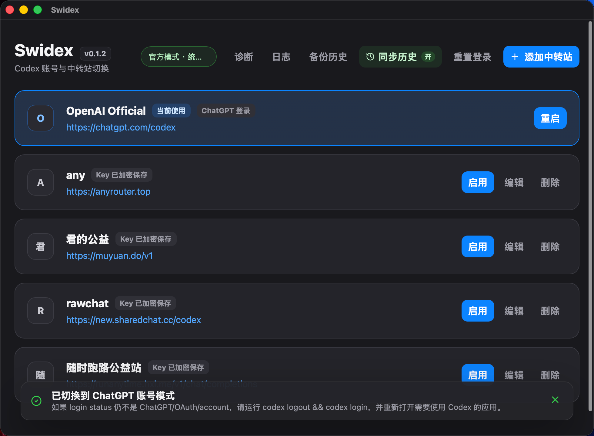
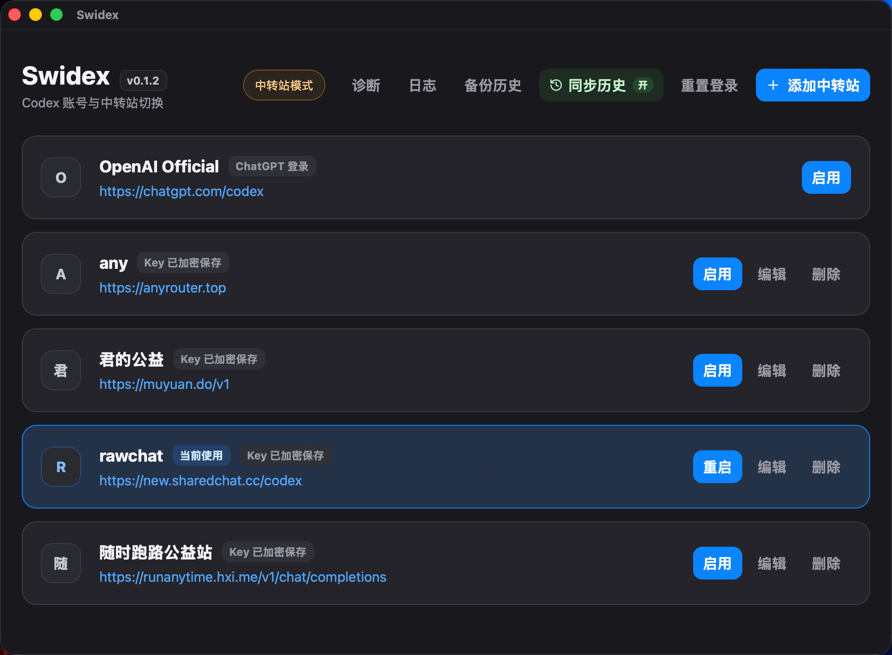
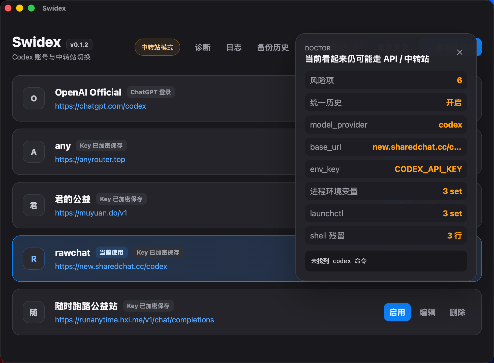

<div align="center">

# Swidex

### 让 Codex 的账号与中转站切换，清楚、干净、可回退

Swidex 是一款专为 macOS 打造的 Codex 桌面工具。在 **ChatGPT 官方账号** 与 **API / 中转站** 之间切换时，它会替你检查真实状态、清理配置残留、保护 API Key，并尽可能保持对话历史连续。


</div>



## 为什么需要 Swidex

Codex 的实际请求通道，不只取决于你刚刚登录了哪个账号。

即使已经重新登录 ChatGPT，旧的 `config.toml`、shell 环境变量或 macOS `launchctl` 配置仍可能生效，让请求继续走向之前使用的 API / 中转站。手动排查这些位置既费时间，也容易漏掉某一处残留。

Swidex 把这件事变成一个可观察、可确认、可恢复的流程：

- **看得见**：一键诊断 Codex 当前更可能使用哪条通道，以及风险来自哪里。
- **切得净**：在官方账号与多个中转站之间切换，并处理散落在不同位置的配置。
- **回得去**：关键修改前自动备份，保留操作日志，避免一次切换破坏原有状态。
- **历史不断档**：可选择让官方账号与中转站共用同一份历史 / 续聊列表。
- **密钥不裸奔**：API Key 默认保存到 macOS Keychain，界面元数据与密钥分离。

## 产品理念

Swidex 不想成为又一个庞大的“全能 Provider 管理器”。它只专注一个范围明确、但经常令人困惑的问题：

> 当你切换 Codex 的登录或请求方式时，帮你确认它现在到底走哪里，并把变化控制在你的手里。

因此，Swidex 坚持三个原则：

1. **先诊断，再修改**：先展示当前状态与风险项，不靠猜测决定下一步。
2. **先确认，再切换**：保存中转站不会自动启用；改变请求通道前必须明确确认。
3. **先备份，再清理**：重要文件和历史迁移都有备份，操作结果可追溯。

## 产品界面

### 集中管理并快速切换

保存常用中转站后，可以直接查看当前使用状态并快速启用。Key 与配置资料分开存储，不会在列表或日志中暴露明文。



### 一眼看清真实状态

Doctor 会同时检查配置文件、Codex 登录状态、进程环境、shell 残留和 `launchctl`，将“可能仍在走中转站”的原因集中显示出来。



## 你可以用它做什么

| 能力 | Swidex 会做什么 |
| --- | --- |
| 官方账号模式 | 清理中转站 Provider 与常见环境变量残留，保留现有 ChatGPT 登录 |
| API / 中转站模式 | 管理多个地址与 Key，在确认后写入 Codex 所需配置 |
| 状态诊断 | 检查登录、Provider、Base URL、环境变量、shell 与 `launchctl` |
| 同步对话历史 | 让官方账号与中转站显示在同一个历史 / 续聊列表中 |
| 历史备份 | 备份会话与历史记录，不打包登录凭据 |
| 重置登录 | 单独备份并移除登录缓存，方便重新执行 Codex 登录 |
| 操作日志 | 记录动作、文件变更、备份位置与执行结果摘要 |

## 获取 Swidex

Swidex 目前面向 macOS，当前本地发布产物为 Apple Silicon（`aarch64`）版本。

- 发布 DMG 后，可从 [GitHub Releases](https://github.com/Muggle-akko/swidex/releases) 获取最新版本。
- 尚无适合你设备的构建时，可以按照下方“本地开发与构建”从源码运行。

> [!IMPORTANT]
> 当前本地分享版没有 Apple Developer ID 签名与 Apple 公证。macOS Gatekeeper 可能阻止首次打开；正式公开分发前仍建议完成签名与公证。相关测试说明见“本地分享与 Gatekeeper”。

## 安全与隐私

- API Key 默认保存到 macOS Keychain；浏览器存储只保留中转站元数据和 Key 状态标记。
- 只有主动勾选持久化时，才会额外将 API / Base URL 环境变量写入 `~/.zshrc` 并同步到 `launchctl`。
- 日志不会输出完整 API Key。
- 保存中转站信息不会自动启用，切换请求通道需要二次确认。
- 修改配置前会创建备份；默认不会删除 `auth.json`。
- 历史备份不包含 `auth.json`，不会把登录凭据打包进去。
- 不会删除 `sessions/` 或 `history.jsonl`；重置登录与切换官方模式是两个独立操作。

## 使用边界

“同步对话历史”只调整会话的归类方式，不会把认证方式或当前请求通道混在一起。关闭同步时，Swidex 只还原能由迁移备份确认来源的会话；开启期间新建且无法判断来源的会话会留在共享历史中，以避免误删。

不同供应商对会话数据的处理方式可能不同。跨供应商续聊旧会话时，仍可能因为 `encrypted_content` 无法由另一后端解密而失败。

## Swidex 与通用 Provider 工具

Swidex 的灵感来自 CC Switch 等 Provider 管理工具，但产品目标不同：

```text
通用 Provider 工具：管理多个 AI 工具、供应商、代理与扩展能力
Swidex：专注 Codex 的状态诊断、登录模式切换与配置清理
```

它不会试图替代通用管理器。Swidex 更像一个 **Codex Doctor**：当你只想知道“Codex 现在到底会走官方账号还是中转站”时，它给出更直接、可审计的答案。

## 技术说明

Swidex 会围绕以下本地状态进行诊断和受控修改：

- `~/.codex/config.toml`
- `~/.codex/auth.json`
- `~/.codex/sessions/`、`archived_sessions/` 与 `history.jsonl`
- Codex 本地状态数据库 `state_5.sqlite`
- shell 启动文件中的常见 API / Base URL 环境变量
- macOS `launchctl` 环境变量
- `codex login status`

切换到 API / 中转站模式时，核心配置形态如下：

```toml
model_provider = "codex"

[model_providers.codex]
name = "codex"
wire_api = "responses"
requires_openai_auth = false
base_url = "https://example.com/v1"
supports_websockets = false
env_key = "CODEX_API_KEY"
```

切换到 ChatGPT 官方账号时，Swidex 会移除第三方 `base_url` / `env_key` 及相关环境变量残留，但不会主动删除登录缓存或让你退出账号。

## 本地开发与构建

需要 Node.js、npm、Rust 与 Tauri 的 macOS 构建环境。

```bash
npm install
npm run tauri:dev
```

运行检查与构建：

```bash
npm run build
npm run test:rust
npm run tauri build
```

常见产物路径：

```text
src-tauri/target/release/bundle/macos/Swidex.app
src-tauri/target/release/bundle/dmg/Swidex_0.1.2_aarch64.dmg
```

## 本地分享与 Gatekeeper

没有 Apple Developer ID 时，Tauri 产物通常只能做 ad-hoc 签名。它可以通过应用结构与签名校验，但仍不会获得 Gatekeeper 的正式信任。

仅用于向可信朋友提供测试构建时，可以重新签名并生成本地分享版 DMG：

```bash
bash scripts/resign-local-dmg.sh
```

生成的文件位于：

```text
src-tauri/target/release/bundle/dmg/Swidex_0.1.2_aarch64-local-ad-hoc.dmg
```

安装到 `/Applications` 后，如果 macOS 仍阻止打开，可由测试者明确确认来源后执行：

```bash
xattr -dr com.apple.quarantine /Applications/Swidex.app
open /Applications/Swidex.app
```

这只是面向可信测试的 Gatekeeper 绕过方式，不等同于正式签名和公证。

---

<div align="center">

如果 Swidex 帮你少排查了一次 Codex 配置，欢迎点一个 Star，或提交 Issue 分享你遇到的切换场景。

</div>

### 中转站模型列表（0.1.3）

切换中转站（或再次启用当前站点）时，Swidex 请求 `/v1/models`，按站点返回结果生成 `~/.swidex/codex-models.json`，并配置 Codex 的 `model_catalog_json`。Codex 在 API 模式下不会自动使用官方账号的模型缓存，因此仅重启客户端或刷新缓存无法显示新增模型。

模型的上下文、推理等级、工具和指令元数据从本机 `~/.codex/models_cache.json` 匹配，保留原有隐藏标记。没有匹配元数据的模型（例如图片模型）不会被猜测加入，结果日志会显示数量。如果没有任何匹配，请先切回官方账号刷新模型列表，再启用中转。请求失败或目录无法生成时保留当前通道。

切回官方账号会恢复切换前的自定义目录配置。站点配置、钥匙串、历史记录和 Codex 账号缓存均保留。升级 App 时保留应用标识 `dev.awu.swidex`，替换应用程序包即可，无需删除用户数据。
